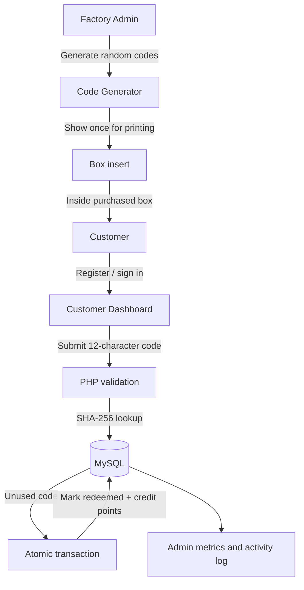

# Architecture

## Stack choice

- **PHP 8.1+**: plain PHP keeps the code approachable for a beginner and avoids framework setup.
- **PDO + MySQL**: parameterized SQL and a server-based database make local evaluation simple. MySQL transactions and constraints protect one-time redemption.
- **Vanilla HTML/CSS/JavaScript**: no compilation step; CSS variables power the theme switch and responsive UI.

## Main components

- `config.php`: session, PDO connection, schema creation, authentication helpers, CSRF and escaping helpers.
- `register.php` / `login.php` / `logout.php`: identity and session lifecycle.
- `dashboard.php`: customer balance, code claim and activity history.
- `admin.php`: code batch generation, programme metrics, activity monitor, redemption review.
- `assets/`: responsive UI, theme toggle and clipboard interaction.

## Data model

| Table | Important fields | Purpose |
|---|---|---|
| `users` | `id`, `email` (unique), `password` (password hash), `role`, `points` | Customer/admin accounts and point balance |
| `box_codes` | `code_hash` (unique), `status`, `points`, `redeemed_by`, `redeemed_at` | Secure single-use proof-of-purchase codes |
| `redemptions` | `user_id`, `reward_name`, `points_cost`, `status` | Reward approval workflow foundation |
| `activity_log` | `user_id`, `action`, `detail`, `created_at` | Admin monitoring and customer history |

## Purchase proof and anti-fraud

A factory admin generates random 12-character codes using `random_bytes(6)`. The plain value is displayed once so it can be printed and inserted into a box. The database stores only its SHA-256 hash. A customer submits the code after purchase. The server normalizes it, hashes it, and checks for a matching unused code. Within a database transaction it conditionally updates the code from `unused` to `redeemed`, then credits points. A unique index prevents duplicate code creation; a conditional update and transaction prevent two requests from claiming the same code. Unknown, malformed, and already-used codes are rejected.

This is a proof-of-possession mechanism rather than receipt verification: only someone with access to the inside-box insert can claim the code. For stronger production controls, use scratch-off inserts, tamper-evident packaging, claim throttling, batch traceability, anomaly alerts, and a support process for damaged inserts.

## System diagram

## Security boundaries

- Passwords use PHP `password_hash()` / `password_verify()`.
- SQL is parameterized with PDO.
- CSRF tokens protect POST forms.
- Output is escaped with `htmlspecialchars`.
- Admin routes enforce the `admin` role.
- Session IDs are regenerated after successful login/registration.
- Never expose the MySQL database or generated clear-text codes publicly.
